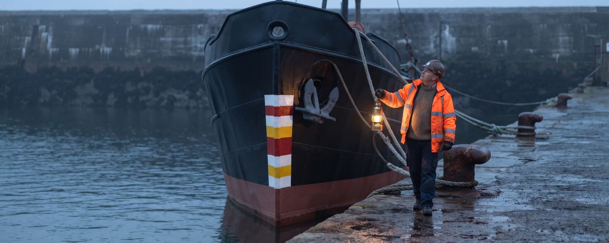
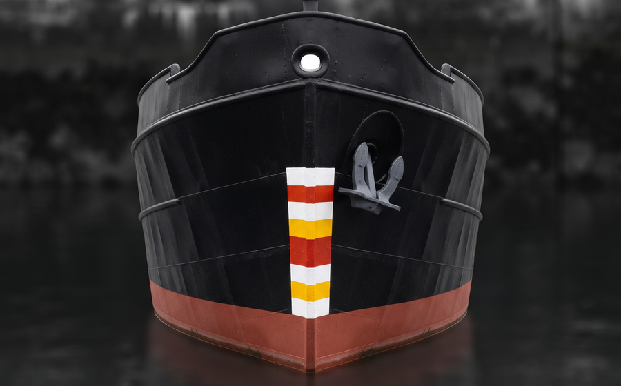

# codeintel-HTTP-Header-Security-Analyzer

Analyzes HTTP response headers for common security misconfigurations (for example missing Strict-Transport-Security, X-Frame-Options, Content-Security-Policy). Focused on tools for static code analysis, vulnerability scanning, and code quality assurance.

> **Presence Only, Values Not Judged.** Each header is judged on presence alone. A Strict-Transport-Security value of max-age=0 still counts as found, and Permissions-Policy is credited where the older Feature-Policy name appears instead. The count records whether the tubes answer, not what the rooms behind the sign hold.

## Install
`git clone https://github.com/ShadowGuard-AI/codeintel-http-header-security-analyzer`

## Usage
`python3 main.py URL [--verbose]`

## Parameters
- `-h`: Show help message and exit
- `url`: The URL to analyze. Required.
- `--verbose`, `-v`: Enable verbose logging.

## Verified behavior
- Against a local server that sends none of the checked headers, the tool reports all six as missing: HSTS, X-Frame-Options, CSP, X-Content-Type-Options, Referrer-Policy, and Permissions-Policy, and exits 0. Read the findings in the output: an exit code of 0 does not mean the headers are present.

> **Frame-Ancestors Counts as Framing Protection.** Framing protection is credited where a Content-Security-Policy carries frame-ancestors, even when X-Frame-Options itself is absent.

## License
See LICENSE.

> **All Six Missing Still Exits 0.** The verified entry above is the caution of this ledger: the printed findings are the verdict and the exit figure is not. A run that finds every header missing still closes at 0.
